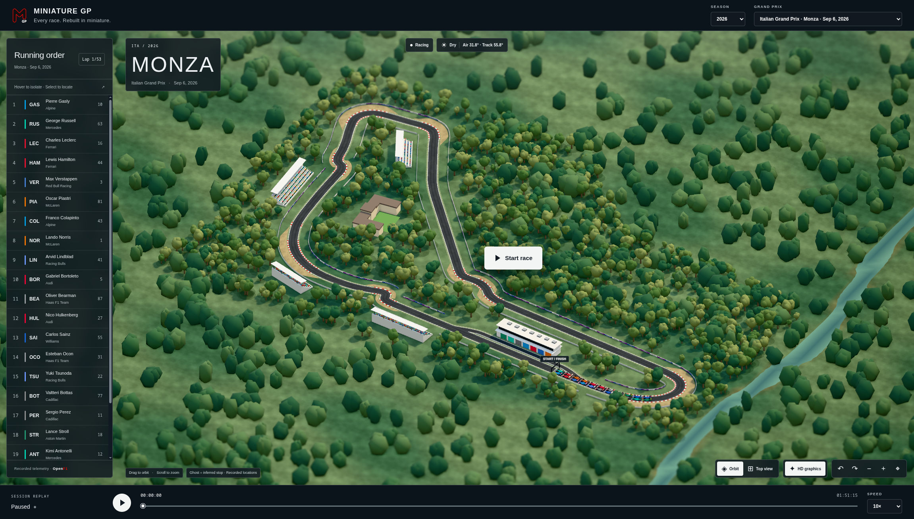

# Miniature GP

Miniature GP turns Formula 1 races into 3D replays. Choose a season and Grand Prix, watch the cars move around the circuit, follow the running order, and explore each race at your own pace. The bundled library currently includes races from **2024, 2025, and 2026**.



## What you can do

- Choose from the available seasons and their completed Grand Prix replays.
- Watch each car follow its recorded positions on a stylized circuit.
- Pause, resume, scrub through the race, or change playback speed from 1× to 100×.
- Follow the running order, lap count, pit stops, race status, and weather.
- Explore each circuit and its surroundings in a 3D scene; drag to orbit and scroll to zoom.

## How it works

The webpage uses React and Three.js. Bundled replay files contain timing, car locations, and race events sourced from [OpenF1](https://openf1.org/). Each replay follows a recorded lap, with a 3D circuit and procedurally built surroundings. Playback reads local files, so watching a race does not call the OpenF1 API.

The season selector reads `public/data/years.json`; each season's Grand Prix selector is populated from its generated race catalog. New circuits use their recorded GPS lap for the track and procedural scenery.

## Run locally

```bash
pnpm install
pnpm dev
```

## Import races

From the repository root, run the importer with Python 3.12 or newer. It discovers completed races for the selected season from OpenF1:

```bash
python scripts/import_races.py
```

To import another season, pass its year:

```bash
python scripts/import_races.py --year 2025
```

The default is the current UTC year. The script downloads missing replays into `public/data/<year>/`, updates that season's `races-<year>.json`, and lists seasons with replays in `public/data/years.json`. Rerunning it skips races already imported; future, cancelled, and unfinished races wait for a later run. OpenF1 temporarily restricts free API access around live sessions, starting 30 minutes before and ending 30 minutes after; the script waits and retries every five minutes when that happens. No Python packages need to be installed.

If you add replay JSON files directly to a year folder, run `python scripts/import_races.py --catalog-only` to refresh all season catalogs without downloading races. `pnpm dev` and `pnpm build` run this refresh before starting, and the import Action refreshes catalogs before committing. Restart the dev server after adding files; the season and Grand Prix selectors will include them.

The [Import current season races](.github/workflows/import-races.yml) GitHub Action runs daily at 04:17 UTC. You can also start it from **Actions → Import current season races → Run workflow** to backfill available races immediately. The Action commits generated replay and catalog files to the branch it runs on.
